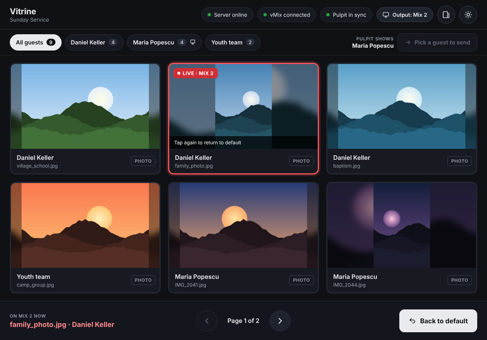
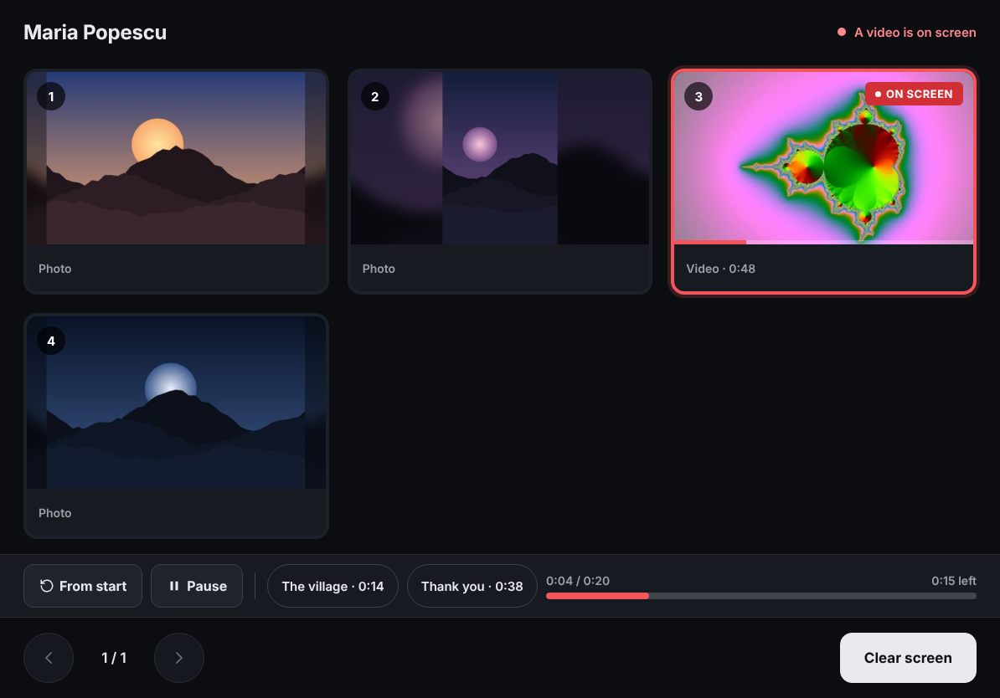
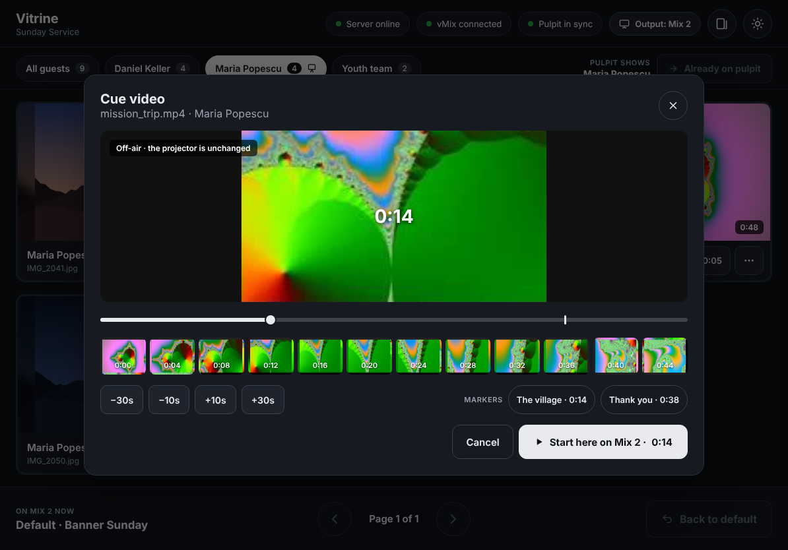
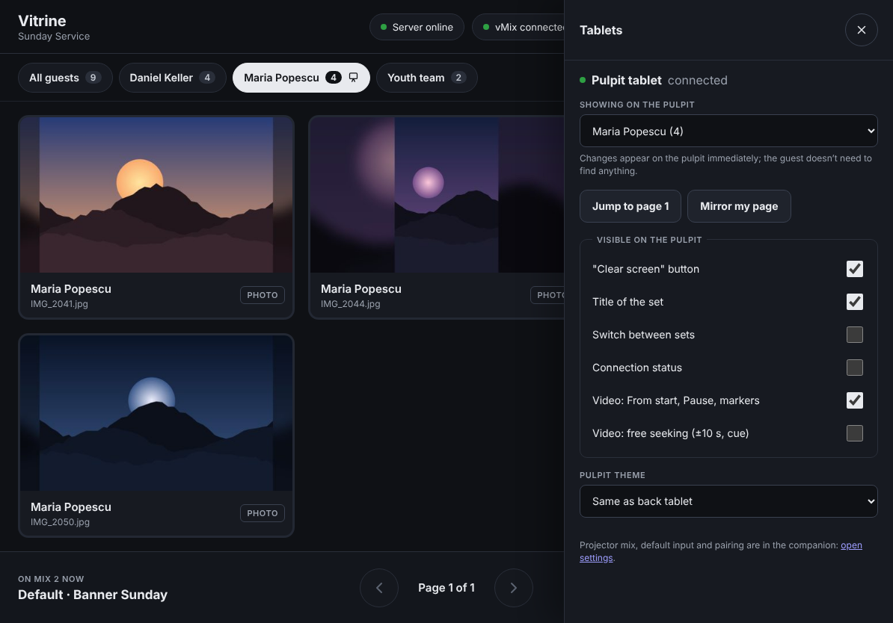
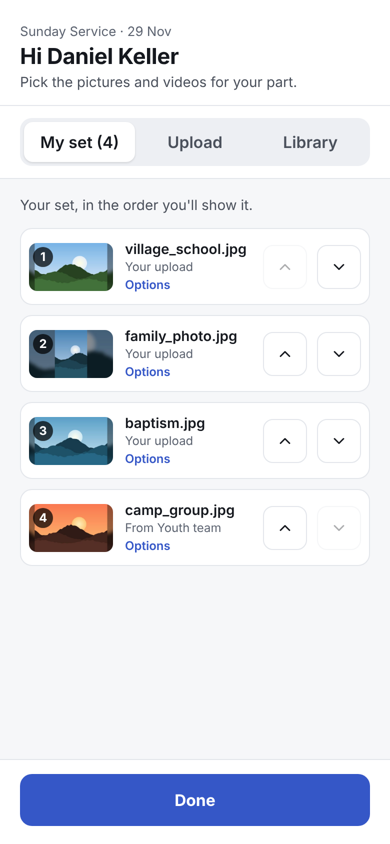
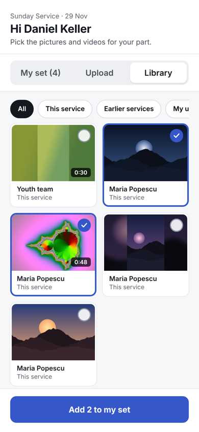
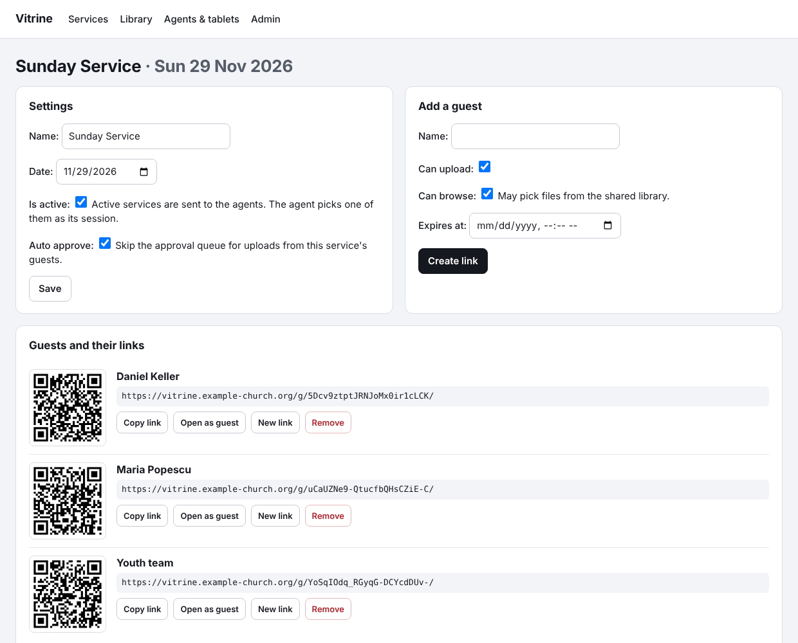
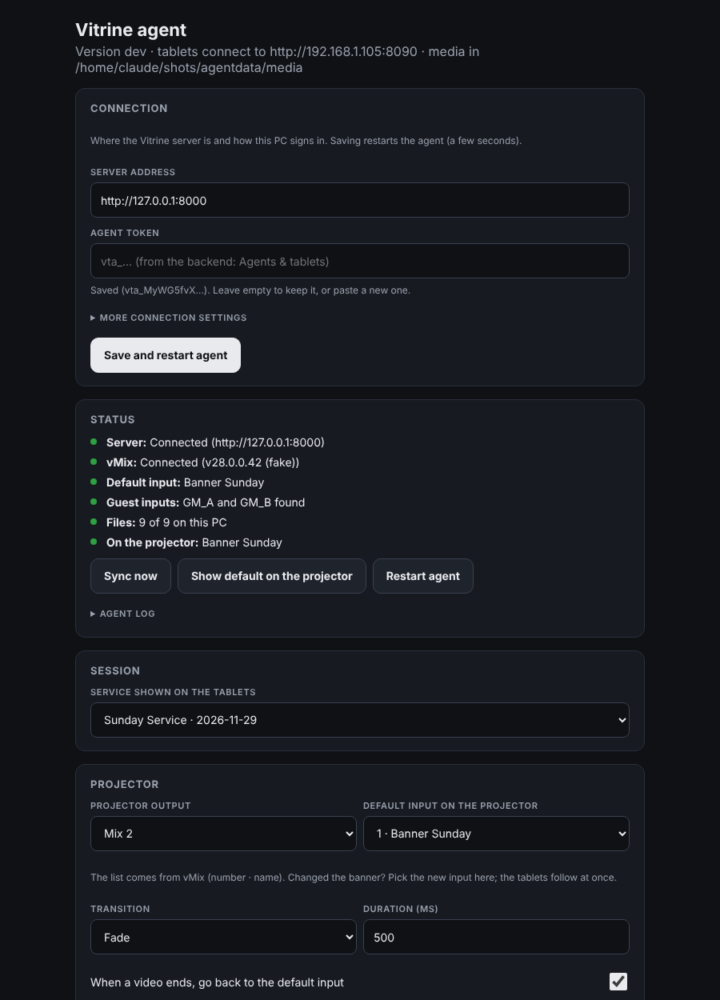

# Vitrine

Guests upload photos and videos through a link, or pick from what others already uploaded. The files are converted for vMix, synced to the vMix PC, and shown on a projector mix from a tablet with one tap: tap again and the projector goes back to the banner.

```
Guests ──upload link──▶ Vitrine server (Portainer: Django + worker + ffmpeg + nginx)
                              │  WebSocket + file sync over Tailscale
                              ▼
              Agent on the vMix PC (Windows service + tray companion)
               ├─ files in a local folder, per guest
               ├─ controls GM_A / GM_B in vMix, fades them onto your projector mix
               └─ serves the tablet pages on the LAN ◀── back tablet + pulpit tablet (paired by QR)
```

## Screenshots

*All names and pictures are made up.*

| Back tablet | Pulpit tablet |
|---|---|
|  |  |
| Tap a tile to put it on the projector mix, tap again for the banner. | Only the guest's set, with the controls you allow. |

| Cue panel | Pulpit settings (from the back) |
|---|---|
|  |  |
| Pick a start point off-air: filmstrip, markers, ±10/30 s. | Choose the pulpit's set, page, buttons and theme. |

| Guest link: my set | Guest link: library |
|---|---|
|  |  |

| Backend: service and guest links | Settings on the vMix PC |
|---|---|
|  |  |

## What it does

- **Photos, videos and audio** (MP3, M4A, WAV…). Audio plays with the default input staying on the projector, or shows its cover/title card, as you choose.
- **Guest link** per guest and service, with a QR code. Guests upload (resumable, so venue Wi-Fi dropouts don't matter), pick files from the shared library, put them in order, and add named start points (markers) to videos.
- **Approval queue** before anything can be shown, plus a library with filters ("not used for 90 days"), bulk delete, a 30-day trash and private files.
- **Conversion** on the server: photos to 1920×1080 with EXIF rotation and a blurred fill for portrait shots; videos to H.264 1080p at your project's frame rate, AAC 48 kHz; thumbnails and a filmstrip for cueing.
- **Agent** on the vMix PC: downloads only what the active service needs, checks every file, slows down downloads while something is live, and keeps working when the internet is down.
- **Back tablet** (`/screen`, role back): all guests, 6 tiles per page, tap = live on your mix, tap again = default input. Sending/live states confirmed by vMix, video progress, From start, ±10 s, pause, markers, Resume where you stopped, a cue panel with filmstrip to pick a start point off-air, and seamless jumps (A/B crossfade). Sends a guest's set to the pulpit and sets what the pulpit shows.
- **Pulpit tablet** (role pulpit): only the guest's tiles and pages, with the options you allow from the back. Dark or light theme.
- **Bitfocus Companion module** ([companion-module-vitrine](https://github.com/silvansan/companion-module-vitrine)): guest and file buttons, Clear screen, transport, markers, and a `live_kind` variable to drive lights and mics with triggers.
- **Tray companion** on the vMix PC: connection (server address, token, folders), restart/start/stop of the agent, projector mix, default input by vMix name (pick again when the banner changes), transition, video-end behaviour, tablets and pairing, the log.

## Quick start

1. **Server**: deploy `deploy/docker-compose.yml` as a Portainer stack, point a Nginx Proxy Manager host at `vitrine-nginx:80`. See [docs/server.md](docs/server.md).
2. **Agent**: in `/manage/agents/` create an agent token. On the vMix PC double-click `vitrine-agent.exe` (it installs or updates itself and opens its settings page), then paste the server address and token under **Connection**. See [docs/agent.md](docs/agent.md).
3. **Tablets**: pair each tablet by scanning a QR code from the backend or the tray companion.
4. **Use it**: create a service, add guests, send them their links. See [docs/usage.md](docs/usage.md).

How it works inside (data model, vMix control, pairing, offline behaviour, APIs): [docs/architecture.md](docs/architecture.md). Moving it into Integr8 later: [docs/integr8.md](docs/integr8.md).

## Repository

| Path | What |
|---|---|
| `server/` | Django project; the app `guestmedia` holds everything (models, guest page, backend, agent API, conversion) |
| `deploy/` | Portainer stack, nginx image and config, environment template |
| `agent/` | Go agent: `cmd/vitrine-agent` (service), `cmd/vitrine-tray` (tray icon), `cmd/vitrine-fakevmix` (vMix stand-in for testing) |
| `agent/internal/web/static/` | Tablet app and companion page (plain HTML/JS, embedded in the agent) |
| `docs/` | Setup and operating guides |

## Development

```bash
# Server (SQLite, no Redis needed; Celery runs inline)
cd server && pip install -r requirements.txt
python manage.py migrate && python manage.py createsuperuser
python manage.py test guestmedia
daphne -p 8000 vitrine_server.asgi:application

# Agent against a fake vMix
cd agent
go test ./...
go run ./cmd/vitrine-fakevmix &
go run ./cmd/vitrine-agent run -config ./dev/config.json
```

GitHub Actions runs both test suites, publishes `ghcr.io/silvansan/vitrine-server` and `ghcr.io/silvansan/vitrine-nginx` (the images the Portainer stack pulls), and builds the Windows executables (attached to releases for `v*` tags).
